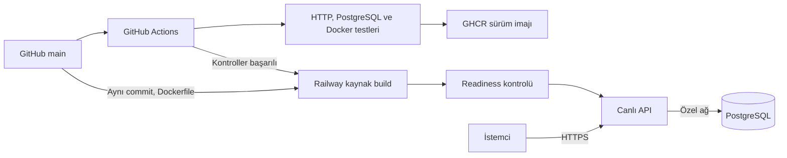

# DevOps Task API

GitHub Actions ile test edilen, Docker ile paketlenen ve Railway üzerinde yayımlanan kişisel DevOps projesi. Görev takip API’si üzerinden uygulama geliştirme, sürekli entegrasyon, dağıtım, gözlemlenebilirlik ve veri kurtarma adımlarını bir araya getirir.

**Geliştirici:** [Mehmet Akif Yıldırım](https://github.com/asdakif)

[Canlı API](https://task-api-production-f53c.up.railway.app) · [Sağlık kontrolü](https://task-api-production-f53c.up.railway.app/health/ready) · [CI çalışmaları](https://github.com/asdakif/devops-lab/actions/workflows/ci.yml) · [Mimari kararlar](docs/architecture.md)

## Projenin odağı

Bir API’yi çalıştırmak, değişiklikleri güvenilir biçimde yayımlamak için tek başına yeterli değildir. Bu proje, kod değişikliğinin testlerden geçmesi, sürüm olarak paketlenmesi, canlıya alınması ve çalışırken gözlemlenmesi için tekrarlanabilir bir süreç oluşturur.

Uygulama alanı bilinçli olarak küçük tutulmuştur: görev oluşturma, listeleme, güncelleme ve silme. Projenin ağırlığı bu uygulamanın etrafındaki teslimat ve operasyon sürecindedir.

## Uygulanan özellikler

| Alan | Uygulama | Kod / yapılandırma |
| --- | --- | --- |
| REST API | Girdi doğrulama, sayfalama, Bearer token, JSON hata yanıtları | [src/app.js](src/app.js) |
| Veri katmanı | PostgreSQL, parametreli sorgular, bağlantı havuzu, kalıcı kayıtlar | [src/store.js](src/store.js) |
| Konteyner | Çok aşamalı Docker build, root olmayan kullanıcı, healthcheck | [Dockerfile](Dockerfile) |
| Yerel ortam | API, PostgreSQL ve isteğe bağlı Prometheus | [compose.yaml](compose.yaml) |
| CI | HTTP ve PostgreSQL testleri, Docker smoke, yedek/restore testi, Prometheus yapılandırma kontrolü | [GitHub Actions](.github/workflows/ci.yml) |
| Sürümleme | GHCR’ye commit SHA etiketiyle imaj yükleme | [CI package işi](.github/workflows/ci.yml) |
| Canlı dağıtım | GitHub kontrollerini bekleyen Railway bağlantısı ve readiness kontrolü | [Canlı servis ayarları](infra/railway-production.json) |
| Gözlemlenebilirlik | İstek kimlikli JSON logları, sayaçlar, gecikme histogramı ve veritabanı metriği | [src/app.js](src/app.js), [monitoring/](monitoring/) |
| Kurtarma | PostgreSQL yedeği, ayrı veritabanına restore, Compose için imaj geri alma betikleri | [scripts/](scripts/), [operasyon rehberi](docs/operations.md) |

## Mimari ve dağıtım akışı



Railway, GitHub’daki kaynak koddan kendi imajını oluşturur. GHCR imajı ayrıca sürüm çıktısı olarak saklanır ve alternatif Linux/Compose dağıtımında kullanılabilir. Aktif canlı dağıtım GitHub Actions içindeki SSH işiyle yapılmaz; bu iş isteğe bağlıdır ve mevcut kurulumda kapalıdır.

### Ortamların kapsamı

| Bileşen | Yerel / CI | Canlı Railway |
| --- | --- | --- |
| API + veritabanı | Docker Compose, PostgreSQL 17 | Ayrı API ve PostgreSQL 18 servisleri |
| Sağlık kontrolü | Docker healthcheck | HTTPS readiness ve Railway dağıtım kontrolü |
| Prometheus | `monitoring` profili; üç alarm kuralı | Henüz kurulmadı |
| Yedek / restore | Betikler ve gerçek verili otomatik test | Bu repo üzerinden zamanlanmış yedek kurulmadı |
| Sürüm geri alma | Compose betikleri | Railway dağıtım geçmişi üzerinden yönetim |

Salt okunur dosya sistemi, yeteneklerin kaldırılması ve localhost port kısıtları Compose ayarlarıdır; Railway’e otomatik taşındıkları varsayılmaz.

## Canlı demoyu inceleme

Arayüz yerine JSON dönen bir REST API sunulur. Genel sağlık uçları token gerektirmez:

```bash
curl -fsS https://task-api-production-f53c.up.railway.app/health/ready
```

Başarılı yanıt `status: "ready"` ve yayımlanan Git commit’inin SHA değerini içerir. Böylece [GitHub commit geçmişi](https://github.com/asdakif/devops-lab/commits/main/) ile çalışan sürüm karşılaştırılabilir.

`/tasks` ve `/metrics` uçları token gerektirir. Kimlik bilgileri repoda paylaşılmaz; görev işlemleri için yerel kurulumu kullanabilir veya yetkili erişimle canlı smoke testini çalıştırabilirsin.

## Yerelde çalıştırma

Gerekenler: Node.js 24, npm, çalışan Docker ve Compose v2. Depoya erişimin varsa:

```bash
git clone https://github.com/asdakif/devops-lab.git
cd devops-lab
npm ci
npm run setup
docker compose --profile monitoring up -d --build --wait
npm run smoke
```

`npm run setup`, rastgele kimlik bilgilerini `.env` dosyasına yazar; mevcut dosyayı korur. API [localhost:3080](http://localhost:3080), Prometheus [localhost:9095](http://localhost:9095) adresinden erişilir. `npm run smoke`, geçici bir görev üzerinde oluşturma, okuma, güncelleme ve silme işlemlerini doğrular.

[API örnekleri, geliştirme modu ve tüm komutlar →](docs/local-development.md)

## Test ve doğrulama

| Kontrol | Kapsam |
| --- | --- |
| `npm run check` | API kaynak dosyalarının sözdizimi |
| `npm test` | HTTP davranışı, token kontrolü, geçersiz girdi, veritabanı kesintisi yanıtları, metrik/log davranışı |
| `npm run test:integration` | Gerçek PostgreSQL üzerinde CRUD, bağlantılar arasında veri kalıcılığı ve tekrarlanan şema kurulumu |
| `npm run smoke` | Çalışan sistemde readiness, kimlik doğrulama, CRUD ve metrik uçları |
| `npm run test:backup` | Gerçek bir görevin yedeklenip ayrı veritabanına yüklenmesi ve mevcut hedefin korunması |

Entegrasyon testi için ayrı `TEST_DATABASE_URL`, smoke ve yedek testi için çalışan servisler gerekir. Ayrıntılar [yerel geliştirme rehberindedir](docs/local-development.md).

CI, PR ve `main` push’larında bu kontrolleri çalıştırır. Başarılı `main` çalışması imajı yayımlar; Railway, GitHub kontrolleri tamamlandıktan sonra dağıtıma geçer. Test sonuçlarının güncel kaynağı [Actions geçmişidir](https://github.com/asdakif/devops-lab/actions).

## Tasarım kararları ve sınırlar

- **Tek servis ve ilişkisel veritabanı:** Küçük uygulama alanı, test ve dağıtım akışını takip etmeyi kolaylaştırır.
- **Ayrı liveness/readiness uçları:** Sürecin çalışması ile veritabanına erişebilmesi ayrı ayrı ölçülür.
- **Ortak Bearer token:** Bu sürüm tek kullanıcı/operatör kullanımına yöneliktir; kullanıcı hesapları, roller ve görev sahipliği bulunmaz.
- **Kontrollü metrik etiketleri:** Her görev UUID’si için ayrı metrik serisi üretilmez.
- **Basit şema kurulumu:** Başlangıçta tablo oluşturulur; sürümlü bir migration altyapısı henüz yoktur.

Prometheus alarm kuralları mevcuttur; haricî bildirim alıcısı bağlı değildir. Yük testi, yüksek erişilebilirlik ve kesintisiz dağıtım garantisi bu projenin doğrulanmış kapsamına dahil değildir. [Kararların gerekçeleri ve ödünleşimleri →](docs/architecture.md)

## Sonraki geliştirmeler

- [ ] Canlı Prometheus/Alertmanager kurulumu ve bildirim kanalı.
- [ ] Zamanlanmış, uzak konuma alınan yedekler ve düzenli kurtarma doğrulaması.
- [ ] Sürümlü veritabanı migration’ları ve staging ortamı.
- [ ] Ölçülebilir yük testi senaryoları ve gecikme/hata oranı hedefleri.
- [ ] Yerel ve canlı PostgreSQL ana sürümlerinin eşitlenmesi.

## Rehberler

- [Yerel geliştirme ve API kullanımı](docs/local-development.md)
- [Mimari kararlar](docs/architecture.md)
- [Canlı dağıtım ve alternatif Linux kurulumu](docs/deployment.md)
- [Arıza, yedekleme ve geri dönüş senaryoları](docs/operations.md)
- [Proje sunumu ve demo akışı](docs/project-walkthrough.md)
