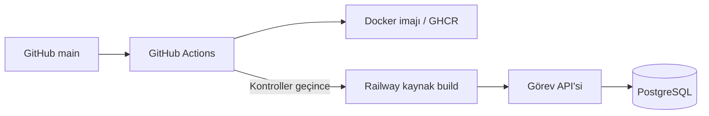

# DevOps Task API

DevOps pratiği yapmak için geliştirdiğim küçük bir görev takip API’si. Node.js ve PostgreSQL kullanıyor; görev oluşturma, listeleme, güncelleme ve silme işlemleri var. Bu proje üzerinde test, Docker, otomatik dağıtım ve izleme tarafını çalışıyorum.

[Canlı API](https://task-api-production-f53c.up.railway.app) · [Sağlık kontrolü](https://task-api-production-f53c.up.railway.app/health/ready) · [GitHub Actions](https://github.com/asdakif/devops-lab/actions/workflows/ci.yml)

## Nasıl çalışıyor?



PR ve `main` push’larında HTTP testleri, PostgreSQL entegrasyon testi ve Docker ortamındaki smoke/yedek testleri çalışıyor. Başarılı `main` çalışmaları GHCR’ye bir imaj yüklüyor. Railway de GitHub kontrollerini bekleyip aynı commit’i kaynak koddan build ederek yayımlıyor.

`/health/live` uygulamanın yanıt verdiğini, `/health/ready` veritabanına erişebildiğini gösteriyor. Sağlık yanıtındaki commit SHA ile canlıda hangi sürümün çalıştığı görülebiliyor.

## Yerelde çalıştırma

Node.js 24, npm ve çalışan Docker Compose v2 gerekiyor.

```bash
git clone https://github.com/asdakif/devops-lab.git
cd devops-lab
npm ci
npm run setup
docker compose --profile monitoring up -d --build --wait
npm run smoke
```

`npm run setup`, yerel parola ve API token’ını üretip `.env` dosyasına yazıyor. API [localhost:3080](http://localhost:3080), Prometheus [localhost:9095](http://localhost:9095) üzerinde açılıyor.

`/tasks` ve `/metrics` için Bearer token gerekiyor. Görev oluşturma örnekleri ve geliştirme komutları [yerel kullanım rehberinde](docs/local-development.md).

## Testler

```bash
npm run check
npm test
```

Gerçek PostgreSQL testi için `npm run test:integration` ve ayrı bir `TEST_DATABASE_URL` kullanılıyor. Çalışan Compose ortamında `npm run smoke` görev işlemlerini, `npm run test:backup` ise yedeğin ayrı bir veritabanına geri yüklenmesini kontrol ediyor.

## Şu anki durum

- API ve PostgreSQL Railway’de çalışıyor; otomatik dağıtım bağlı.
- Prometheus, alarm kuralları ve yedekleme betikleri yerel ortamda. Canlı izleme, bildirim ve zamanlanmış uzak yedekleme henüz kurulmadı.
- Kullanıcı hesabı ve görev sahipliği yok; erişim ortak bir API token’ıyla sağlanıyor.
- Yerel PostgreSQL 17, canlı veritabanı 18. Sürümleri eşitlemek ve sürümlü migration eklemek sonraki işler arasında.

## Notlar

- [Yerel geliştirme ve API komutları](docs/local-development.md)
- [Mimari kararlar](docs/architecture.md)
- [Dağıtım ayarları](docs/deployment.md)
- [Arıza ve geri yükleme senaryoları](docs/operations.md)
